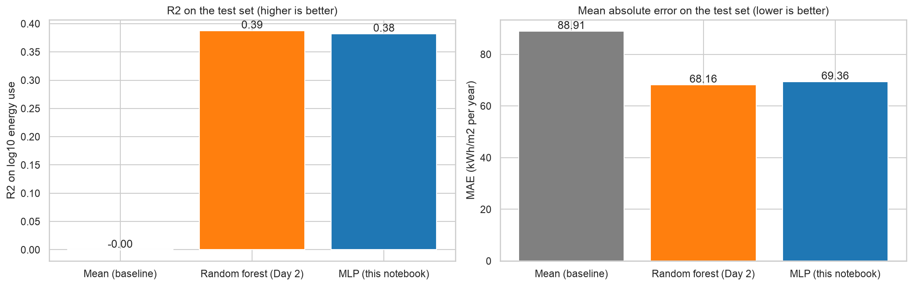
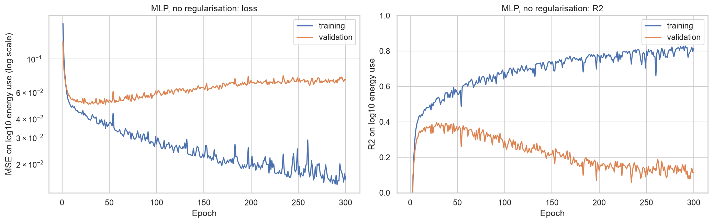
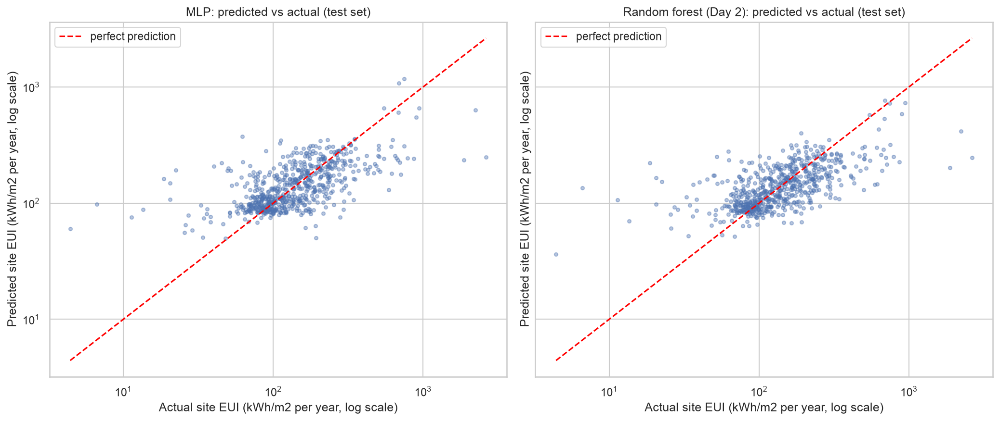
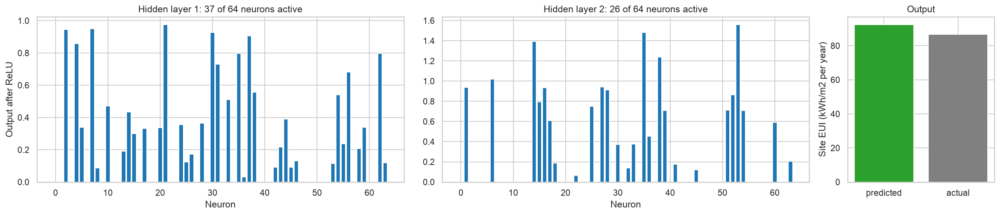

# Seattle buildings: energy use per m2 with a small neural network

Chloe Hraibeh, Jeff El Khoury, Luca Obejdeanu
AI Methods I, Day 4 (neural networks), IAAC MaAI 2026/27
Track A1: an MLP on tables

**Model on Hugging Face:** https://huggingface.co/iaac-maai/day4-team6-energy-use-mlp



## Use case

The same question as our Day 2 model: an architect doing a feasibility study for a new building in Seattle wants a first idea of its yearly energy use per m2, before anything is designed in detail. They only know the use, the size, the number of floors, the year and the location. The costly mistake is underestimating: the bills end up higher and the building can miss the city's energy targets. Here we check if a neural network does better than our Day 2 random forest.

## Dataset

| | |
|---|---|
| Name | 2016 Building Energy Benchmarking (Seattle) |
| Source | Kaggle, [city-of-seattle/sea-building-energy-benchmarking](https://www.kaggle.com/datasets/city-of-seattle/sea-building-energy-benchmarking) |
| Cleaning | in our [Day 1 repo](https://github.com/iaac-maai/6-day1-assignment) |
| One row | one building |
| Rows used | 3,211 (train 2,054, validation 514, test 643) |
| Licence | Public Domain |

## Repo

```
data/         the clean table, downloaded by the notebook (not committed)
figures/      plots exported by the notebook
models/       README.md = the model card (+ its 4 figures); model.pt and scaler.joblib are only on Hugging Face
notebook/     neural_network.ipynb
.gitignore
LICENSE
README.md
requirements.txt
```

## How to run

```bash
python -m venv .venv
source .venv/bin/activate        # Windows: .venv\Scripts\activate
pip install torch==2.14.1 --index-url https://download.pytorch.org/whl/cpu
pip install -r requirements.txt
```

Open `notebook/neural_network.ipynb`, select `.venv` and run all. The notebook reads the clean table from our Day 1 repo (fixed to one commit) and downloads our Day 2 model from Hugging Face as the baseline. It saves the plots in `figures/`, and the weights, the preprocessing and the model card figures in `models/`. We trained on a laptop CPU: 300 epochs take about 8 seconds.

## Approach

- **Target:** `site_eui_kwh_m2` (energy per m2 in a year) on a log10 scale, the same as Day 2.
- **Inputs (11):** use, city building type, neighborhood, year built, floors, number of buildings, floor area, area per floor, parking share, latitude, longitude. The preprocessing (median for missing values, scaling, one-hot) turns them into 50 inputs, fitted on the training buildings only.
- **Split:** the same test set as our Day 2 model (`test_size=0.2`, `random_state=42`), so the comparison is fair. 20% of the training buildings are kept for validation.
- **Network:** a PyTorch MLP, 50 → 64 → 64 → 1 with ReLU (7,489 parameters), MSE loss, Adam with learning rate 0.001, batches of 32.
- **Baselines:** our Day 2 random forest, downloaded from Hugging Face and scored on the same test set, and the mean.
- **Experiment:** on the validation set, no regularisation against early stopping, dropout with weight decay, and a smaller network.

## Results

Test set (643 buildings, used once):

| | Mean (baseline) | Day 2 random forest | MLP |
|---|---|---|---|
| R2 (log10) | 0.00 | 0.387 | 0.382 |
| MAE | 89 kWh/m2 | 68 kWh/m2 | 69 kWh/m2 |
| Typical error | 66% | 45% | 46% |
| Underestimated | 49% | 49% | 46% |

The network ties with the random forest: it doesn't beat it. On a table of 2,000 rows and 11 columns a neural network brings no gain, and it's harder to explain and to reuse.



Without regularisation the network memorises the training buildings: the validation loss is lowest at epoch 28 and then goes up, and after 300 epochs R2 is 0.81 on training and 0.11 on validation.

| Validation set | Epochs run | R2 |
|---|---|---|
| no regularisation | 300 | 0.113 |
| early stopping (final model) | 58 | 0.396 |
| dropout 0.3 + weight decay + early stopping | 119 | 0.387 |
| 16 neurons + early stopping | 106 | 0.385 |

All three remedies work about the same; what matters is stopping in time. The final model keeps the weights of epoch 28.



Both models pull their predictions towards the middle, and the two are correlated at 0.90. They fail on different buildings, though: the network is worse on high-rise apartments (median error 29% against 16%), mixed use and schools, and better on large offices (26% against 36%), hotels and medical offices.



A low-rise apartment building from 1989 going through the network: 37 of the 64 neurons of the first layer and 26 of the second are active, and the output is 92 kWh/m2 against 87 in reality.

## Limitations

- R2 0.38: it explains less than half of the differences. Energy depends a lot on how the building is used (hours, equipment, people), which isn't in the data.
- The network learned on 2,054 buildings and the random forest on 2,568, so the comparison slightly favours the random forest.
- One seed and one validation split: the ranking of the experiments is within noise.
- Only big buildings, only Seattle, only 2016, self-reported data. Not for data centers, labs or very mixed buildings, or as an exact number for a design decision.

## AI usage

| | |
|---|---|
| Tools | Claude Code (agent) |
| Why | to go faster with the PyTorch code, which is new for us, and with the first drafts of the texts |
| Where | the notebook code, the first drafts of the texts and the model card |
| How | we asked it to keep the Day 2 split and inputs so the comparison is fair, then went through every section and checked the numbers in the texts against the outputs |

Lessons learned: the training loss alone says the network keeps improving for all 300 epochs. Only the validation curve shows it memorising the buildings after about 30 epochs, so you have to plot both.

## License

MIT for the code and the model, the data is public domain.
